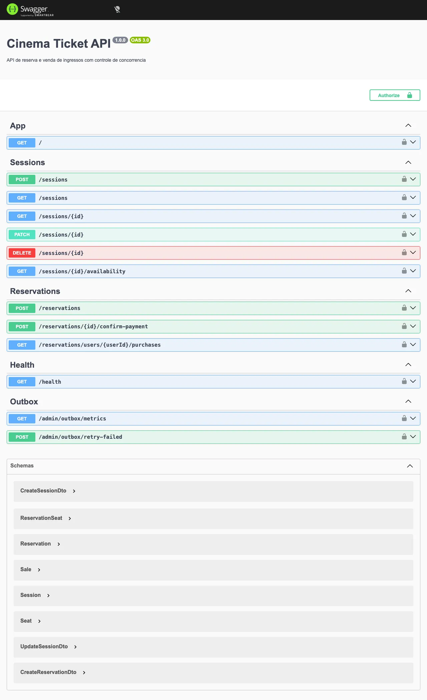
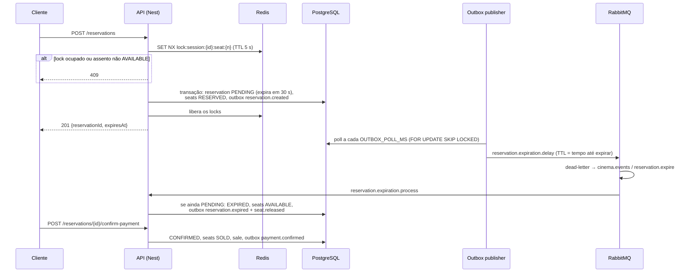
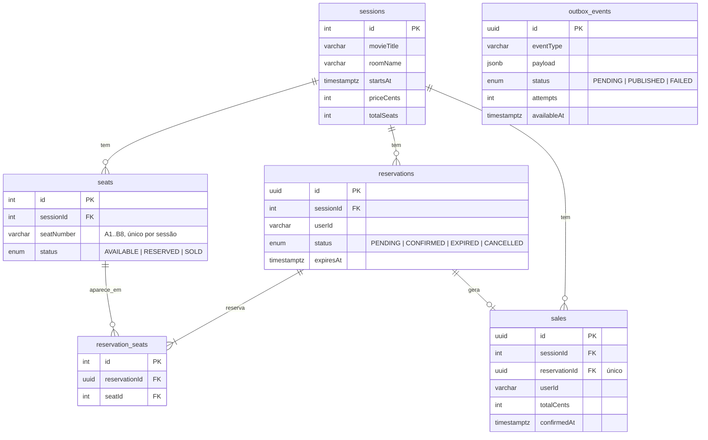
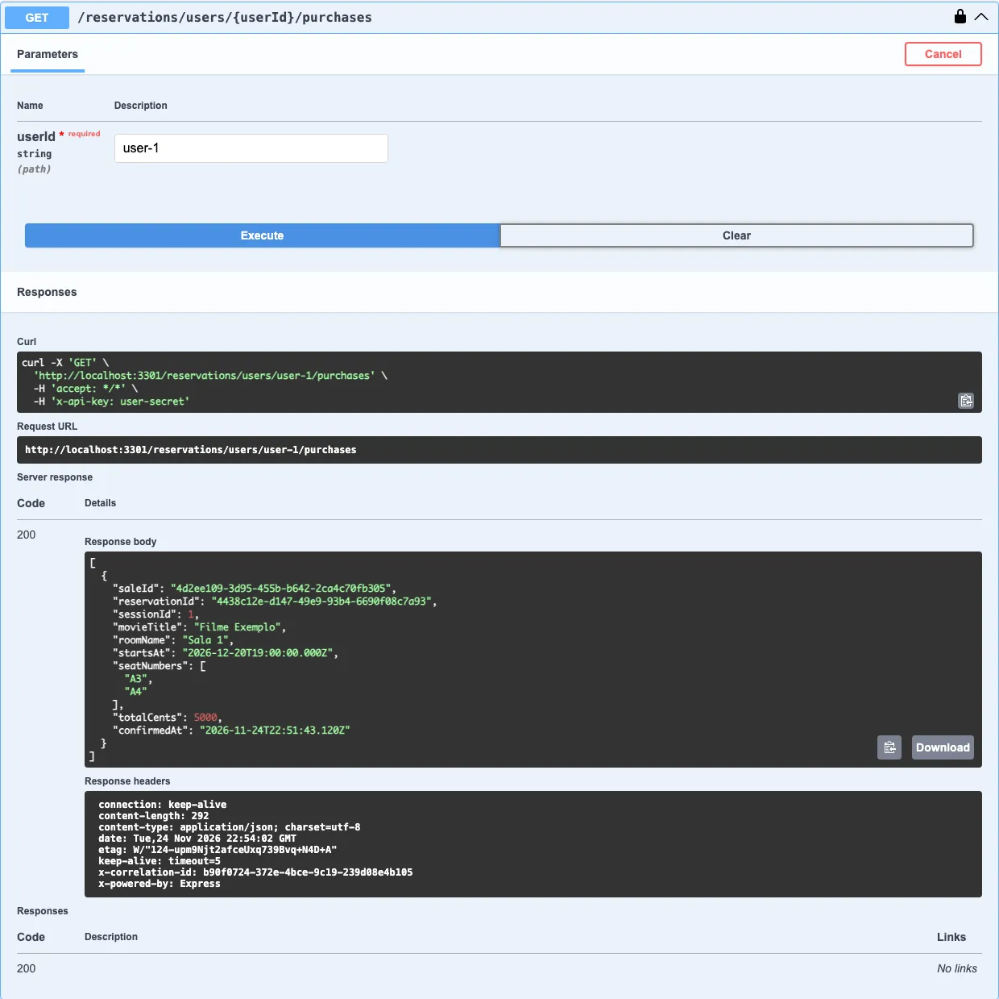

# Cinema Ticket API - NestJS

API para reserva e venda de ingressos de cinema com foco em controle de concorrência e consistência de dados.

Objetivos da implementação:
- evitar venda dupla do mesmo assento;
- expirar reservas em 30 segundos quando não confirmadas;
- processar expiração de forma assíncrona;
- garantir publicação confiável de eventos.

Desafio técnico de backend da Starsoft.



## Stack
- NestJS
- PostgreSQL
- Redis
- RabbitMQ
- TypeORM
- Swagger/OpenAPI

## Arquitetura e Decisões
- `PostgreSQL` para persistência transacional e integridade relacional.
- `Redis` para lock distribuído por assento no fluxo de reserva.
- `RabbitMQ` para mensageria de expiração e eventos de domínio.
- `Outbox Pattern` para consistência entre commit no banco e publish no broker.
- `AuthGuard` global com API key para autenticação.
- `RolesGuard` global para autorização por perfil (`ADMIN` e `USER`).
- `priceCents` em vez de float para valores monetários.
- `FOR UPDATE SKIP LOCKED` no publisher do outbox para coordenação entre múltiplas instâncias.

### Fluxo de reserva



### Modelo de dados

Tabelas criadas pelo TypeORM (`DB_SYNC=true`, sem migrations):



Os assentos são gerados na criação da sessão: 8 por fileira (`A1`…`A8`, `B1`…`B8`), mínimo 16.

## Como Executar
### Pré-requisitos
- Node.js 20+
- npm
- Docker + Docker Compose

### 1) Configurar ambiente
```bash
cp .env.example .env
```

### 2) Subir aplicação + infraestrutura com Docker
```bash
docker compose up -d --build
```

API:
- `http://localhost:3001`

Swagger:
- `http://localhost:3001/api-docs`

RabbitMQ Management:
- `http://localhost:15672` (user: `cinema`, pass: `cinema`)

### 3) Rodar localmente (opcional)
Se preferir rodar a API fora do container:
```bash
npm install
npm run start:dev
```
Mantenha Postgres, Redis e RabbitMQ ativos no Docker.

## Autenticação e Autorização
Modelo adotado:
- Header `x-api-key` (ou `Authorization: Bearer <api-key>`).
- Perfis:
- `ADMIN`: gerencia sessões e endpoints admin do outbox.
- `USER`: faz reserva, confirma pagamento e consulta próprio histórico.

Variáveis de ambiente:
- `AUTH_ENABLED=true`
- `AUTH_ADMIN_API_KEY=admin-secret`
- `AUTH_USER_API_KEY=user-secret`
- `AUTH_ADMIN_USER_ID=admin-1`
- `AUTH_DEFAULT_USER_ID=user-1`

Regras de autorização:
- Sessões:
- `POST/PATCH/DELETE /sessions` -> `ADMIN`
- `GET /sessions*` -> `USER` ou `ADMIN`
- Reservas:
- `POST /reservations` -> `USER`/`ADMIN` (usuário comum só pode reservar para o próprio `userId`)
- `POST /reservations/:id/confirm-payment` -> `USER`/`ADMIN`
- `GET /reservations/users/:userId/purchases` -> `USER`/`ADMIN` (usuário comum só acessa o próprio histórico)
- Outbox:
- `/admin/outbox/*` -> `ADMIN`
- Públicos:
- `GET /` e `GET /health`

## Endpoints
### Aplicação
- `GET /`
- `GET /health`

### Sessions
- `POST /sessions`
- `GET /sessions`
- `GET /sessions/:id`
- `GET /sessions/:id/availability`
- `PATCH /sessions/:id`
- `DELETE /sessions/:id`

### Reservations
- `POST /reservations`
- `POST /reservations/:id/confirm-payment`
- `GET /reservations/users/:userId/purchases`

### Outbox Admin
- `GET /admin/outbox/metrics`
- `POST /admin/outbox/retry-failed`

### Exemplo de fluxo

Saída real com dados fictícios (`x-api-key: user-secret`):

```text
$ POST /reservations   {"sessionId":1,"userId":"user-1","seatNumbers":["A3","A4"]}
{"reservationId":"4438c12e-…","expiresAt":"2026-11-24T22:52:13.112Z","seatNumbers":["A3","A4"],"status":"PENDING"}
$ POST /reservations   (A3 de novo)
{"message":"One or more seats are unavailable","error":"Conflict","statusCode":409}
$ POST /reservations   (userId "user-2" com a chave de usuário)
{"message":"Users can only create reservations for themselves","error":"Forbidden","statusCode":403}
$ POST /reservations/4438c12e-…/confirm-payment
{"id":"4d2ee109-…","sessionId":1,"reservationId":"4438c12e-…","userId":"user-1","totalCents":5000,"confirmedAt":"2026-11-24T22:51:43.120Z"}
$ GET /sessions/1/availability   (sem a lista de assentos)
{"sessionId":1,"totalSeats":16,"availableSeats":14,"reservedSeats":0,"soldSeats":2}
```



### Documentação da API

- Swagger UI: `http://localhost:3001/api-docs` (JSON em `/api-docs-json`). Clique em **Authorize** e informe `admin-secret` ou `user-secret`.
- OpenAPI 3 exportado: [`docs/openapi.json`](docs/openapi.json) (abre em [editor.swagger.io](https://editor.swagger.io)).
- Postman: coleção e ambiente em [`postman/`](postman/) (veja a seção Testes).

## Eventos de Domínio
- `reservation.created`
- `reservation.expire`
- `reservation.expired`
- `seat.released`
- `payment.confirmed`

## Estrutura

```
src/
├── main.ts            # correlation id, ValidationPipe, Swagger em /api-docs
├── auth/              # ApiKeyAuthGuard + RolesGuard globais, @Public, @Roles, @CurrentUser
├── sessions/          # CRUD de sessões, geração de assentos, disponibilidade
├── reservations/      # reserva com lock, confirmação, histórico, consumer de expiração
├── seats/ sales/      # entidades
├── outbox/            # tabela outbox, publisher com polling, endpoints admin
├── messaging/         # conexão RabbitMQ, exchange cinema.events, fila de delay (DLX)
├── redis/             # cliente e lock distribuído (SET NX + TTL)
└── health/            # GET /health (checa o banco)
scripts/concurrency-test.mjs
postman/               # coleção + ambiente local
docs/                  # openapi.json e imagens
```

## Testes
### Teste de concorrência
```bash
API_URL=http://localhost:3001 npm run test:concurrency
```
Esperado: apenas 1 requisição reserva o assento com sucesso; as demais retornam `409`.

Hoje o script não envia `x-api-key`, então com `AUTH_ENABLED=true` todas as chamadas voltam `401` (e com `AUTH_ENABLED=false` voltam `403`/`500`, veja Limitações conhecidas). Enquanto isso, o mesmo teste com `curl` e a chave de admin:

```bash
for i in $(seq 1 10); do
  curl -s -o /dev/null -w "%{http_code}\n" -X POST http://localhost:3001/reservations \
    -H 'x-api-key: admin-secret' -H 'Content-Type: application/json' \
    -d "{\"sessionId\":1,\"userId\":\"user-$i\",\"seatNumbers\":[\"B6\"]}" &
done | sort | uniq -c; wait
#   1 201
#   9 409
```

### Testes automatizados
`npm test` roda só o spec gerado do `AppController` (1 teste). `npm run lint` acusa 8 erros pré-existentes em `src/auth`.

### Postman
Arquivos prontos para importação:
- `postman/Cinema-Ticket-API.postman_collection.json`
- `postman/Cinema-Ticket-API.local.postman_environment.json`

A collection já envia `x-api-key` automaticamente:
- endpoints de usuário usam `{{userApiKey}}`
- endpoints administrativos usam `{{adminApiKey}}`

## Requisitos Obrigatórios
- `NestJS` + `Docker` + `PostgreSQL` + `Redis` + `RabbitMQ`.
- Reserva de assentos com expiração de 30 segundos.
- Proteção contra concorrência na reserva.
- Fluxo principal de sessão, reserva e confirmação de pagamento.
- API documentada via Swagger.

## Requisitos Opcionais
- Histórico de compras por usuário (`GET /reservations/users/:userId/purchases`).
- Endpoints administrativos do outbox para métricas e reprocessamento.

## Pontos Extras
- Outbox Pattern com polling e retry.
- Correlation ID propagado de HTTP para mensageria.
- Script de teste de concorrência para validação prática.

## Limitações Atuais
- Sem suíte completa de testes unitários e integração.
- Sem CDC (ex.: Debezium) para o outbox (atualmente polling).
- Sem dashboard dedicado de observabilidade do outbox.

## Motivo das Limitações Restantes
- Testes unitários/integração completos:
- foco do desafio foi provar o fluxo crítico de concorrência e consistência distribuída; foi priorizado teste funcional (Postman + script de concorrência) para validar comportamento fim a fim.
- CDC para outbox:
- exige infraestrutura adicional (Kafka + Connect + Debezium) e operação mais complexa; polling foi escolhido por simplicidade e menor custo operacional para o escopo do desafio.
- Dashboard de observabilidade:
- foi entregue endpoint de métricas (`/admin/outbox/metrics`) como base; dashboard/alertas exigem stack extra (Prometheus/Grafana/ELK), fora do escopo principal de implementação.

## Limitações conhecidas

Encontradas rodando a API localmente:

- **Reserva que nunca expira**: a mensagem de expiração usa TTL = `expiresAt - agora` no momento do publish e às vezes chega alguns milissegundos antes de `expiresAt`. O consumer vê `expiresAt > Date.now()`, ignora e não há nova tentativa: a reserva fica `PENDING` e os assentos `RESERVED` para sempre.
- `confirm-payment` de uma reserva vencida marca `EXPIRED` e libera os assentos, mas lança o `409` dentro da mesma transação, então tudo sofre rollback e a reserva continua `PENDING`.
- `confirm-payment` não confere o dono: qualquer `USER` confirma a reserva de outro usuário se souber o id. Id que não é UUID retorna `500`.
- `scripts/concurrency-test.mjs` não envia `x-api-key` (401 com auth ligada). Com `AUTH_ENABLED=false`, o `RolesGuard` ainda exige usuário (`403` em `POST /sessions`) e `POST /reservations` quebra ao ler `user.role` (`500`).
- Sem listener de `error` na conexão do RabbitMQ: um `Heartbeat timeout` (ex.: máquina suspensa) derruba o processo.
- `PATCH /sessions/:id` com `totalSeats` muda só o número; os assentos não são criados nem removidos.

## Melhorias Futuras
- JWT + RBAC.
- Migrations versionadas para produção.
- Idempotency keys no `confirm-payment`.
- Monitoramento e alertas para saúde do outbox.
